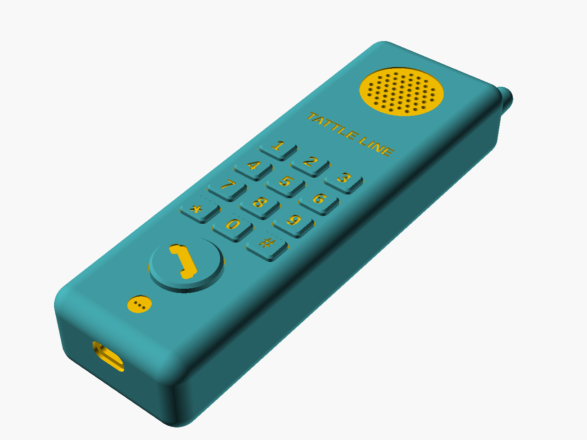
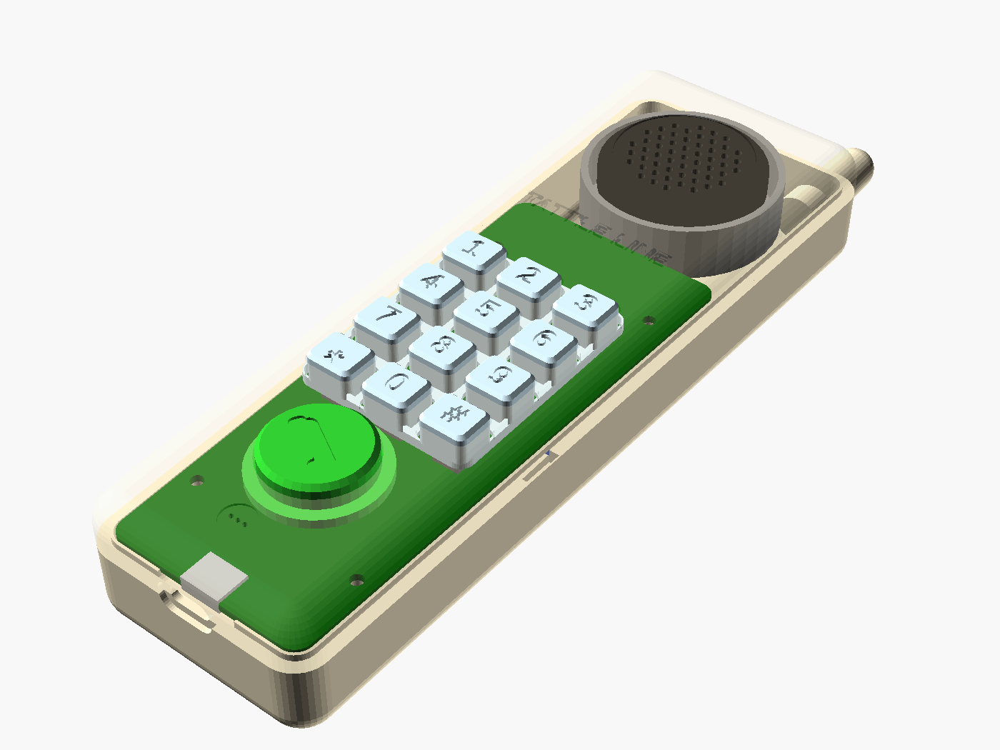
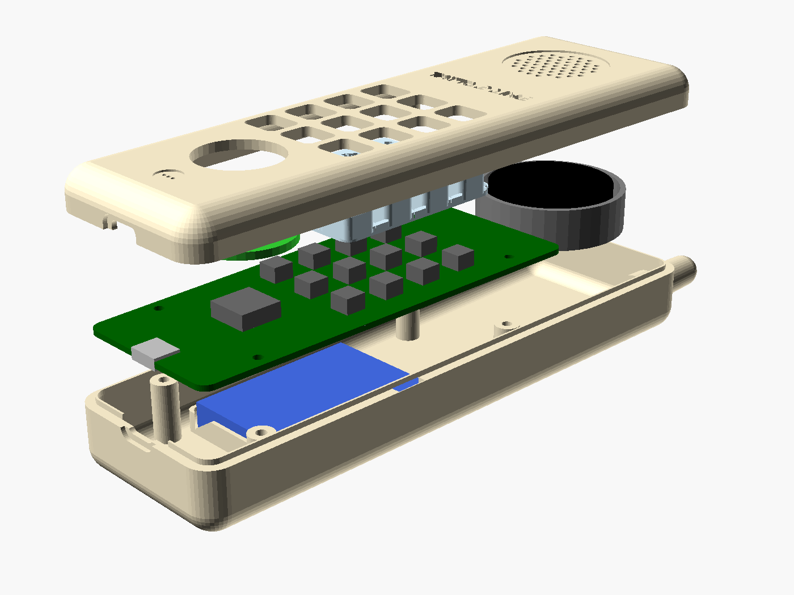

# 📞 Tattle Phone

A toddler-proof "phone" shaped like a 90s cordless handset. Press the big
CALL button and it rings, beeps, then records whatever your kid has to report.
The recording goes to a Google Drive folder and you get an email on your phone.
Later the keypad can light up and play sounds.

It's a custom PCB, an ESP32-S3, and a 3D-printed shell, with a rechargeable
LiPo and USB-C charging.

```
tattle-phone/
├── README.md                     ← this design doc
├── firmware/tattle_phone/        ← Arduino sketch (phase 1: record + upload)
│   ├── tattle_phone.ino
│   ├── pins.h                    ← one pin map for breadboard AND PCB
│   └── config.example.h          ← copy to config.h, add Wi-Fi + URL
├── cloud/drive_upload.gs         ← Google Apps Script: receives WAV → Drive + email
├── hardware/
│   ├── README.md                 ← PCB guide: schematic by block, footprints, layout
│   ├── layout.py                 ← shared dimensions for the board AND the case
│   └── place_footprints.py       ← KiCad script: draws outline, places keys/LEDs/holes
└── enclosure/
    ├── tattle_phone.scad         ← parametric OpenSCAD model (shells, keypad, CALL cap)
    ├── layout.scad               ← generated from hardware/layout.py
    ├── Makefile                  ← `make` → STLs + pcb_outline.dxf, `make renders`
    ├── stl/                      ← ready-to-slice parts
    └── renders/                  ← preview images
```

---

## 1. System overview

```
           USB-C ──► ESD ──► BQ24074 charger ──► 1S LiPo (1200–2000 mAh, protected)
             │  (CC 5.1k)         │ power-path "SYS"                │
             │                    ▼                                 ▼
             │            TPS63001 buck-boost 3.3 V          MAX17048 fuel gauge (I2C)
             │                    │
             └─ D+/D- ────────────┤ (flashing + serial over the same USB-C)
                                  ▼
   ┌──────────────── ESP32-S3-WROOM-1-N16R8 ─────────────────┐
   │  Wi-Fi 2.4 GHz · 16 MB flash (outbox) · 8 MB PSRAM       │
   │                                                          │
   │  I2S0 RX ◄── ICS-43434 / INMP441 MEMS mic                │
   │  I2S1 TX ──► MAX98357A 3 W amp ──► 28–40 mm 8 Ω speaker   │
   │  GPIO7   ◄── big CALL button (wakes from deep sleep)     │
   │  GPIO8   ──► 13× SK6812 LEDs (call + 12 keys)            │
   │  GPIO11  ──► P-FET LED power switch                      │
   │  I2C     ◄─► MAX17048 gauge, PCA9555 keypad expander      │
   └──────────────────────────────────────────────────────────┘
                                  │ HTTPS POST (base64 WAV)
                                  ▼
          Google Apps Script web app ──► Drive folder "Tattles" + email to you
```

### Key decisions (and why)

| Decision | Choice | Why |
|---|---|---|
| MCU | **ESP32-S3-WROOM-1-N16R8** | Wi-Fi, two I2S buses, native USB (no USB-UART chip needed), 8 MB PSRAM holds a 60 s recording in RAM, 16 MB flash is the "onboard memory". Pre-certified module = no RF design. |
| Storage | **On-board flash (FAT partition, ~9.9 MB)** | ≈ 5 min of 16 kHz audio as an *outbox*. Tattles queue there if Wi-Fi is down and upload later. No SD card to lose or eat. Add a microSD footprint only if you want to keep an on-device archive. |
| Mic | **ICS-43434** (PCB) / **INMP441 breakout** (prototype) | Digital I2S out, so no analog noise to fight on a board with Wi-Fi and a class-D amp. |
| Speaker amp | **MAX98357A** | I2S in, speaker out. Has a shutdown pin, so it's silent and draws nothing at idle. |
| Charging | **BQ24074** | Has power path, so the phone works while plugged in and the battery isn't cycled. Has a thermistor input (use it, there's a toddler involved) and 1.5 A max (set ~500 mA–1 A for a small cell). TP4056 modules are fine for the breadboard. |
| 3.3 V rail | **TPS63001 buck-boost** | Holds 3.3 V across the whole LiPo range (3.0–4.2 V) through Wi-Fi's 300–500 mA bursts. An LDO browns out once the cell drops below ~3.6 V. |
| Battery gauge | **MAX17048** | Accurate %, ~4 µA. Lets the phone show "low battery" (red keypad blink) and lets the upload carry battery %. |
| LEDs | **SK6812 MINI-E** (reverse-mount) | One data pin for all 13. Reverse-mount LEDs shine *up through* the PCB next to each switch, into translucent keycaps. |
| Cloud | **Google Apps Script** | Free, no server, writes straight to your Drive, and emails you so your phone pings. A home server alternative is in §6. |

---

## 2. Bill of materials

### Phase 1, breadboard prototype (~$45)

| Qty | Part | Notes |
|---|---|---|
| 1 | ESP32-S3-DevKitC-1 **N16R8** | Must be the R8 (PSRAM) variant |
| 1 | INMP441 I2S mic breakout | L/R → GND |
| 1 | MAX98357A breakout | Adafruit #3006 or clone |
| 1 | 40 mm 8 Ω 1–3 W speaker | |
| 1 | 30 mm arcade button or 12 mm tact switch | The CALL button |
| 1 | WS2812B strip/stick, a few LEDs | Stand-in for the keypad LEDs |
| 1 | 1S LiPo + TP4056 USB-C charger module | Optional at this stage, USB power is fine |

### Phase 3, custom PCB (approx. per board at JLCPCB qty 5 with assembly)

| Ref | Part | LCSC-ish cost |
|---|---|---|
| U1 | ESP32-S3-WROOM-1-N16R8 | $4.50 |
| U2 | BQ24074RGTR (charger, power path) | $1.80 |
| U3 | TPS63001DRCR (3.3 V buck-boost) + 1.5 µH inductor | $2.20 |
| U4 | MAX98357AETE+ | $1.20 |
| U5 | ICS-43434 (bottom-port mic) | $1.60 |
| U6 | MAX17048G+T10 fuel gauge | $1.20 |
| U7 | PCA9555PW 16-bit IO expander (keypad) | $0.60 |
| U8 | SN74AHCT1G125 (LED data level shift) | $0.10 |
| Q2 | 2N7002 (drives the LED P-FET gate) | $0.02 |
| SW14 | Side slide switch (hard power off via charger SYSOFF) | $0.10 |
| J1 | USB-C 16-pin receptacle (mid-mount or top) | $0.30 |
| D1 | USBLC6-2SC6 ESD on D+/D- | $0.10 |
| LED1–13 | SK6812 MINI-E | $0.10 ea |
| SW1–13 | 6×6 mm tact switches (or Kailh low-profile) | $0.05 ea |
| Q1 | AO3401 P-FET (LED power gate) | $0.05 |
| J2 | JST-PH 2-pin battery, J3 JST-PH 2-pin speaker | $0.10 |
| — | Passives: 5.1 kΩ CC pull-downs ×2, 10 kΩ NTC, decoupling, etc. | ~$1 |
| BT1 | 1S LiPo 1200–2000 mAh **with protection PCB**, e.g. 103450 | $6–10 |

Expect ~$15–20 per board assembled at qty 5, plus about $25 in shipping and setup.

---

## 3. Power and battery life

| State | Current | Notes |
|---|---|---|
| Deep sleep | ~25–50 µA | ESP32 ~10 µA + buck-boost Iq + gauge + charger leakage. **LED rail must be switched off** (13 LEDs idle ≈ 13 mA). |
| Awake, idle | ~40 mA | |
| Recording | ~60–80 mA | Wi-Fi off while recording |
| Uploading | 150–300 mA avg, 500 mA peaks | ~3–10 s per tattle |

A 1500 mAh cell gives **months** of standby. Even at 20 tattles a day it should
go 2–3 weeks between charges. Use the fuel gauge to blink the keypad red under 15%.

Also add a **hard power slide switch** on the BQ24074's SYSOFF pin for travel and
storage. It disconnects the battery from the system, and charging still works with it off.

---

## 4. PCB design notes (KiCad)

- **2 layers, 1.6 mm**, shaped to fit the handset's inner profile (a ~45 × 150 mm
  rounded rectangle). Export the outline from your CAD as DXF → KiCad Edge.Cuts
  so board and shell match exactly.
- **Antenna keep-out:** put the ESP32 module at the *top end* of the board with
  the antenna hanging past the board edge (or with the copper/ground pour cut
  out under it per Espressif's guide). Keep the battery, speaker magnet and
  screws away from it.
- **Layout from top to bottom of the handset** (like a real phone):
  earpiece speaker → ESP32/antenna → keypad (12 keys + LEDs) → CALL button →
  mic port at the bottom ("mouthpiece") → USB-C in the bottom end face.
- **Mic:** ICS-43434 is bottom-ported. Drill a 1 mm hole under it, and add a printed
  port + foam/felt gasket in the shell so sound reaches it and the speaker doesn't
  feed back through the inside of the case.
- **USB-C:** CC1 and CC2 each get their own 5.1 kΩ to GND. If they share one
  resistor, C-to-C chargers won't supply power. Route D+/D- as a pair to GPIO19/20 through
  the ESD diode. Add BOOT (GPIO0) and RESET tact switches or test pads.
- **Charger:** set ISET for ~0.5C (e.g. 750 mA for a 1500 mAh cell). Wire the
  NTC to TS and glue the thermistor to the cell.
- **Decoupling:** follow the datasheets. Use a big bulk cap (≥ 22 µF, ideally
  100 µF) near the ESP32 for Wi-Fi bursts and another at the amp.
- **Assembly:** the S3 module, QFN charger, LGA mic and SK6812 MINI-E are hard to
  hand-solder. Let **JLCPCB/PCBWay assembly** place them, then hand-solder the
  JST connectors and big button yourself.
- Add **test points**: VBAT, SYS, 3V3, GND, I2S lines, and a header footprint for
  a serial adapter in case native USB ever gets wedged.

---

## 5. Enclosure (3D printing)

**The model is in [`enclosure/`](enclosure/).** It's a parametric OpenSCAD design
(175 × 52–58 × 30 mm) with front and back shells, a one-piece 12-key keypad on a
flexible web, a CALL cap and a speaker back-box. Print-ready STLs are in
`enclosure/stl/`. Change any dimension in `hardware/layout.py`, run `make`, and
the case and the KiCad board outline update together.

| Part | Material | Print orientation / notes |
|---|---|---|
| `front.stl` | PETG/ASA, "almond" or any color | Face-down. Brim helps on the rounded edges |
| `back.stl` | same | Back-down. Tree supports under the antenna nub only |
| `keypad.stl` | **Translucent/natural PETG** | As exported (web on the bed). Numbers are engraved so the LEDs glow through them |
| `call_cap.stl` | Green PETG | As exported (flange on the bed) |
| `speaker_cup.stl` | anything | Glue over the speaker ring with the wire through the hole, then seal it |

Hardware: 4 × M2.5 × 18 screws (Torx/tri-wing) + 4 × M2.5 heat-set inserts
(≈ 3.6 mm OD × 4 mm), thin foam for the battery pocket, and a 1 mm felt/foam
gasket for the mic duct.





### Design notes

Inspired by the classic chunky cordless handset, as an original design: a
tapered brick with a slight banana curve, a stubby fake antenna nub on top, an
earpiece grille near the top, a keypad, and a big CALL key.

- **CAD:** Fusion 360 or Onshape. Import the PCB as STEP from KiCad and build
  the shell around it. Model the board first, then the shell.
- **Two shells (front/back)** split along the side, joined with **M2.5 screws into
  heat-set inserts**. Use Torx or tri-wing heads so little hands can't open it.
- **Material:** PETG or ASA for the shell (tougher than PLA and doesn't shatter
  when thrown). 2.5–3 mm walls, 4+ perimeters, 30%+ infill. Add a TPU bumper
  strip or rubber feet if it's going to get dropped a lot.
- **Keys:** print keycaps in **translucent/natural PETG** so the LEDs glow
  through, with the numbers as raised or recessed text (or a two-color print).
  Design the keypad as **one flexible "membrane" sheet** (TPU or a thin PETG web) so each
  key is held captive and nothing can come off and be swallowed.
- **CALL button:** a big (25–30 mm) green handset-icon key over a 12 mm tact
  switch with its own LED, or just use a 30 mm arcade button.
- **Speaker:** grille holes in the front face near the top, and a sealed printed
  back-box behind the speaker, which makes it noticeably louder and fuller.
- **Mic:** a small hole at the bottom front, ducted to the mic with a gasket.
- **Battery bay:** a separate walled pocket. Make it a snug fit with foam, and keep it away from
  screw bosses so a screw can never be driven into the cell.
- **Charging:** USB-C opening in the bottom end. A stretch goal is a printed
  **charging cradle**: a base with pogo pins or a magnetic USB-C adapter, plus a
  hall sensor/magnet so the phone knows it's "on the hook".

### Toddler safety checklist
- [ ] Protected LiPo cell, charger thermistor connected, fuse or PTC on VBUS
- [ ] Battery fully enclosed, screws need a tool
- [ ] No parts smaller than a toilet-paper-tube opening can come off (keys captive)
- [ ] Volume capped in firmware (`VOLUME_PCT`)
- [ ] No sharp print edges: chamfer/fillet everything ≥ 1 mm
- [ ] Recordings go only to your own Drive, and the upload token is secret

---

## 6. Getting recordings to you

### Option A: Google Apps Script → Drive + email (recommended, already written)
`cloud/drive_upload.gs` is a tiny web app in your Google account. The phone
POSTs the WAV (base64) with a secret token. The script saves it to a Drive
folder and emails you with the audio attached, so your phone gets a notification
and you can play it right from the email. Setup steps are in the file header.
Limits are fine for this use: 60 s max ≈ 2.5 MB per upload, well under Apps
Script's limits.

### Option B: home server
If you have a Raspberry Pi, NAS or Home Assistant box, point `UPLOAD_URL` at a
small HTTP endpoint on your LAN instead. Save the file there, sync to Drive with
`rclone`, and push a notification via **ntfy** or Home Assistant's mobile app.
It's faster and works without internet, but it's one more thing to maintain.

### Hardening (later)
- Replace `tls.setInsecure()` with Google's root CA (`tls.setCACert(...)`).
- Wi-Fi setup without reflashing: add WiFiManager (captive portal on first boot).
- OTA firmware updates (ArduinoOTA or HTTPS OTA), so you don't have to unscrew the case.

---

## 7. Build plan

**Phase 1: breadboard (start here)**
1. Wire the DevKit per `firmware/tattle_phone/pins.h`.
2. Deploy `cloud/drive_upload.gs`, then copy `config.example.h` → `config.h`.
3. Arduino IDE: board "ESP32S3 Dev Module", PSRAM "OPI PSRAM", Flash 16MB,
   Partition "16M Flash (3MB APP/9.9MB FATFS)", USB CDC On Boot enabled.
   Install the **Adafruit NeoPixel** library and use the **esp32 core 3.x**.
4. Flash, open the Serial Monitor, talk, and tune `SPEECH_RMS` (silence
   threshold) and `MIC_SHIFT` (mic gain) from the printed `rms=` values.
5. Press CALL → ring → beep → talk → stop talking → goodbye tones → blue
   chase while uploading → rainbow + chirp means it's in Drive. Orange means it's
   queued for retry.

**Phase 2: keypad and fun**
- 12 keys on a PCA9555 over I2C. A matrix also works, but an expander frees GPIOs
  and can raise an interrupt to wake the chip.
- Each key lights its LED and plays a tone. `playTones()` already does
  dual-tone, so real DTMF pairs are easy.
- Ideas: "speed dial" keys that play a recorded message from Mom/Dad, a
  **voicemail** key that plays your reply (the script could save a reply file the
  phone downloads), a lullaby key, number-learning ("press 3!"), and a
  call-button glow while charging.

**Phase 3: PCB**
- Schematic and layout in KiCad from §2–§4, with the same pin map as `pins.h`.
- Order 5 boards with assembly, and bring them up one rail at a time (USB → charger → 3V3 → ESP32).

**Phase 4: enclosure**
- Rough PLA test fit first, then PETG/ASA final with translucent keys.

**Phase 5: two phones that call each other** (§8)

---

## 8. Two phones calling each other (intercom)

The plan supports this without hardware changes: both phones already have a mic,
speaker, Wi-Fi and a keypad. What changes is mostly firmware and power.

**How a call works**
1. Each phone has a name in `config.h` (`"Kitchen"`, `"Bedroom"`) and announces
   itself on the LAN with mDNS (`_tattle._udp`), so neither needs a fixed IP.
2. Speed-dial: a key with a sticker of the other kid's face (say **2**) sends
   `RING` over UDP. The other phone rings and flashes all its keys.
3. Pressing CALL on the ringing phone answers (`ANSWER`). Either CALL press hangs
   up (`HANGUP`). If nobody answers in 30 s, the caller can leave a message
   (it reuses the tattle recorder and is sent to the other phone instead of Drive).
4. Audio goes over UDP in 20 ms frames: 16 kHz/16-bit = 256 kbit/s raw, or 64 kbit/s
   with IMA-ADPCM. That's trivial for a home network. A ~80 ms jitter buffer
   smooths out Wi-Fi hiccups.

**Half-duplex first, full-duplex later.** With the speaker and mic in the same
small handset, the far end hears itself echo back unless you cancel it.
- **v1, walkie-talkie:** hold CALL to talk and let go to listen. The call LED shows
  who's talking. It's robust, needs no DSP, and kids get it right away.
- **v2, real phone call:** full-duplex with the ESP-SR acoustic echo canceller
  (it runs on the S3, and the PSRAM helps). Earpiece-level volume makes it easier.

**The real constraint is power.** To *receive* a call, a phone has to be awake on
Wi-Fi, but deep sleep is what makes the battery last months.
- **Recommended:** during "play hours" (e.g. 7 am–7 pm, set in config) phones stay
  connected in Wi-Fi power-save + automatic light sleep, which is a few mA on average
  and wakes on an incoming packet within ~0.3 s. At night they go to deep sleep.
  Roughly 50–60 mAh/day, or **3–4 weeks on 1500 mAh**. Size up to a 2000 mAh cell
  (103450 → 104050/105050) if the case allows.
- A phone sitting on its charging cradle (stretch goal, §5) can always answer.
- Fallback: if the other phone doesn't answer, the message waits on it like voicemail.

**Without a router:** ESP-NOW (peer-to-peer Wi-Fi) also works and has lower latency.
Both phones must share the router's channel to use ESP-NOW and normal Wi-Fi at the same time.
That's a later option for car trips or the backyard.

**Firmware restructure this needs:** a FreeRTOS task per job (mic in, speaker out,
network) plus a state machine:
`IDLE → RINGING_OUT / RINGING_IN → IN_CALL → IDLE`, alongside the existing
`RECORDING → UPLOADING` tattle path. Tattle uploads get the phone's name in the
file name so you know which kid called.

---

## Status

- [x] Architecture, BOM, power and PCB/enclosure plan (this doc)
- [x] Phase 1 firmware: ring/beep, record to PSRAM with silence auto-stop, WAV
      outbox on flash, Wi-Fi upload with retry, deep sleep / wake on CALL
- [x] Apps Script Drive receiver with email notification
- [ ] Breadboard bring-up (firmware has not been compiled or run on hardware yet)
- [x] PCB guide: schematic by block, footprints, placement script ([`hardware/`](hardware/))
- [x] Enclosure model v1 + STLs ([`enclosure/`](enclosure/)). Not test-printed yet
- [x] Intercom design (§8)
- [ ] KiCad schematic capture and routing
- [ ] Test print and fit check against a real PCB
- [ ] Intercom firmware
