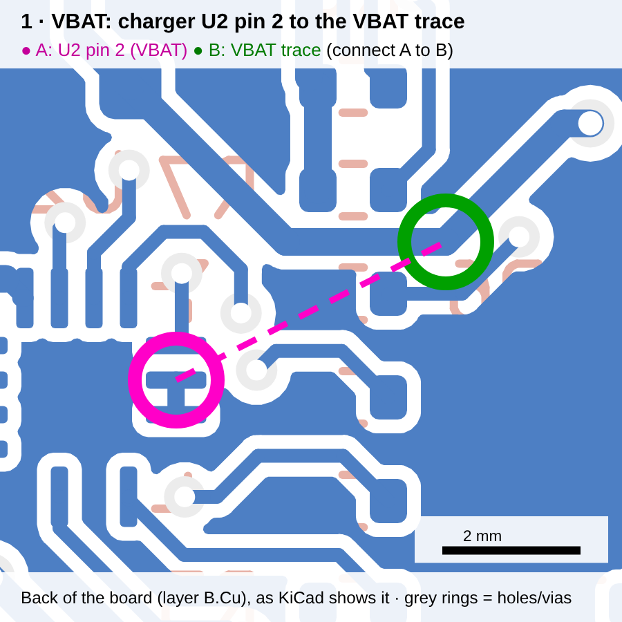
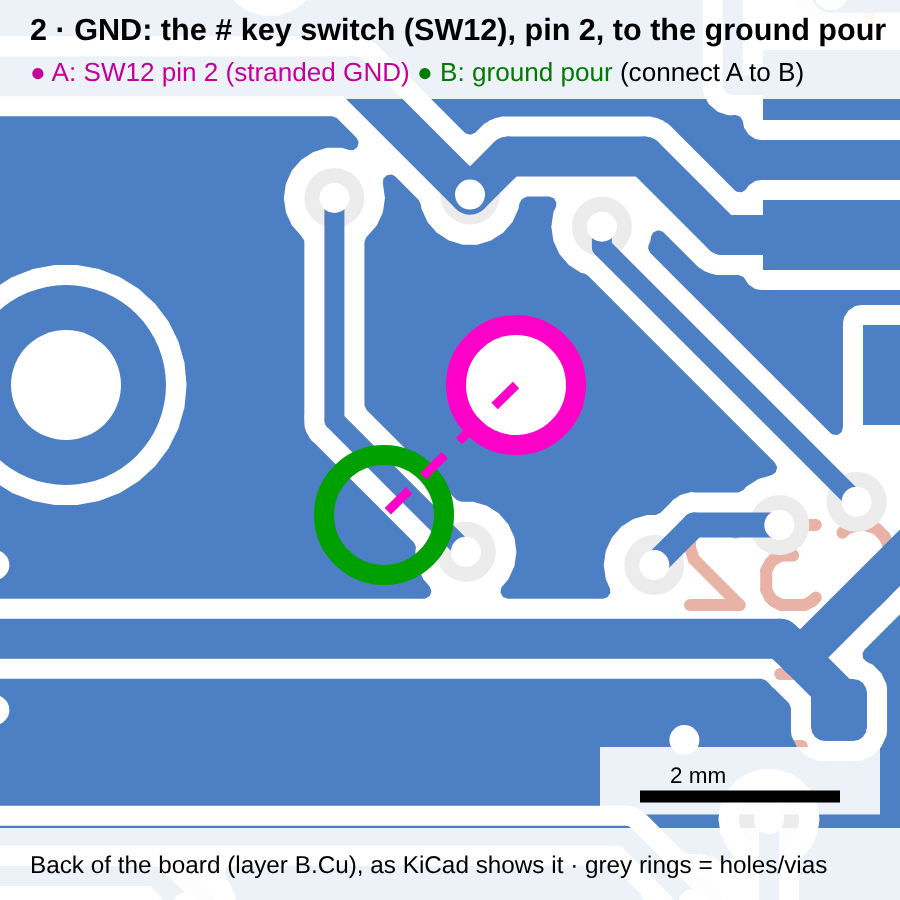
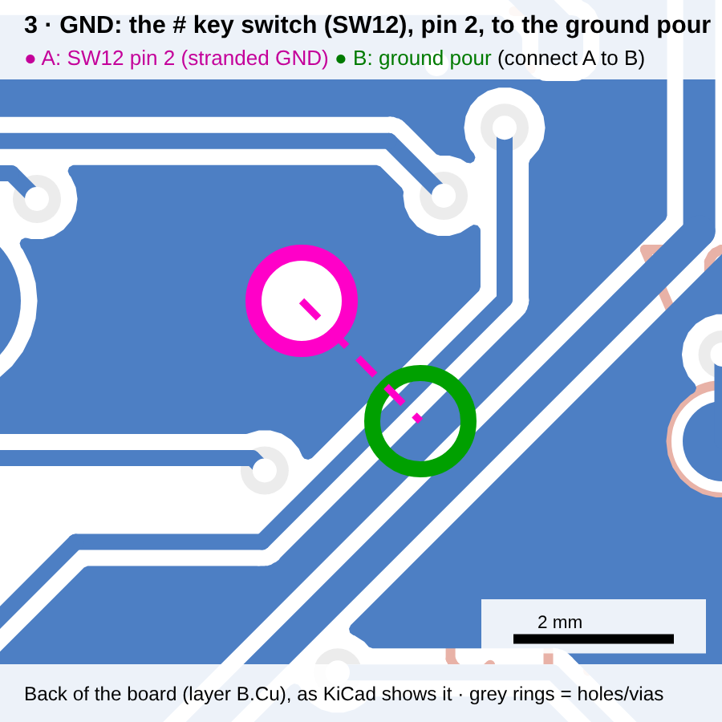
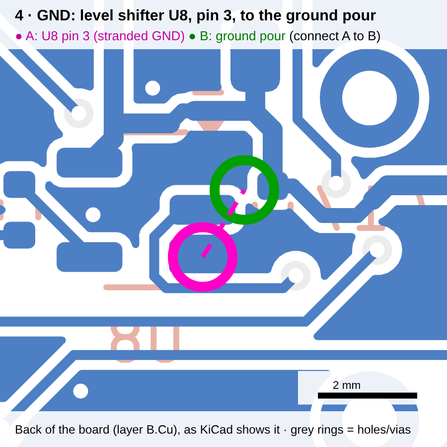
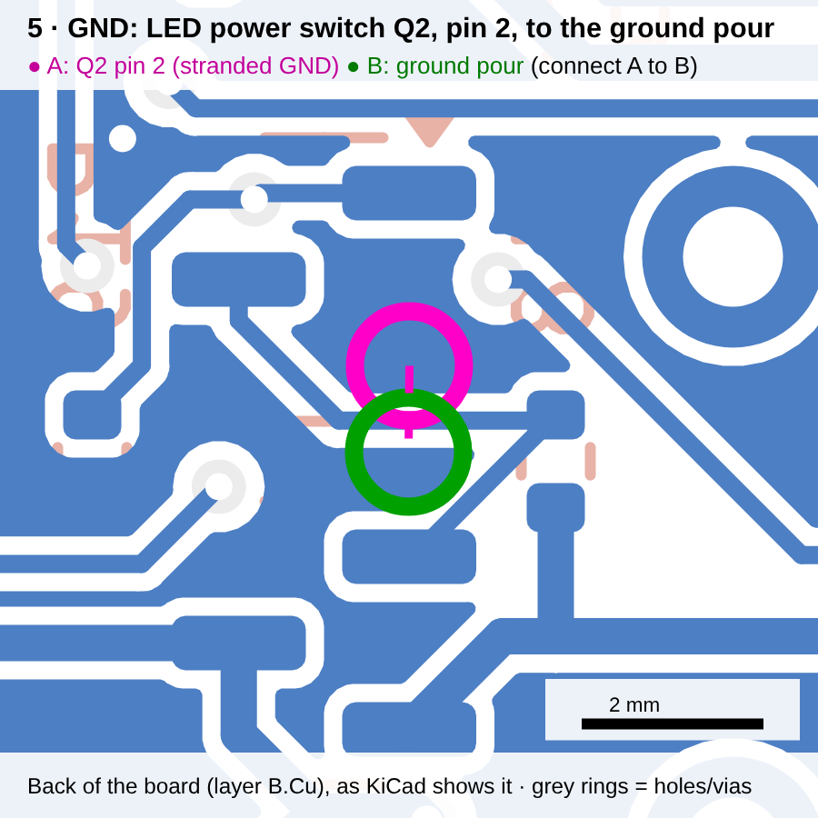
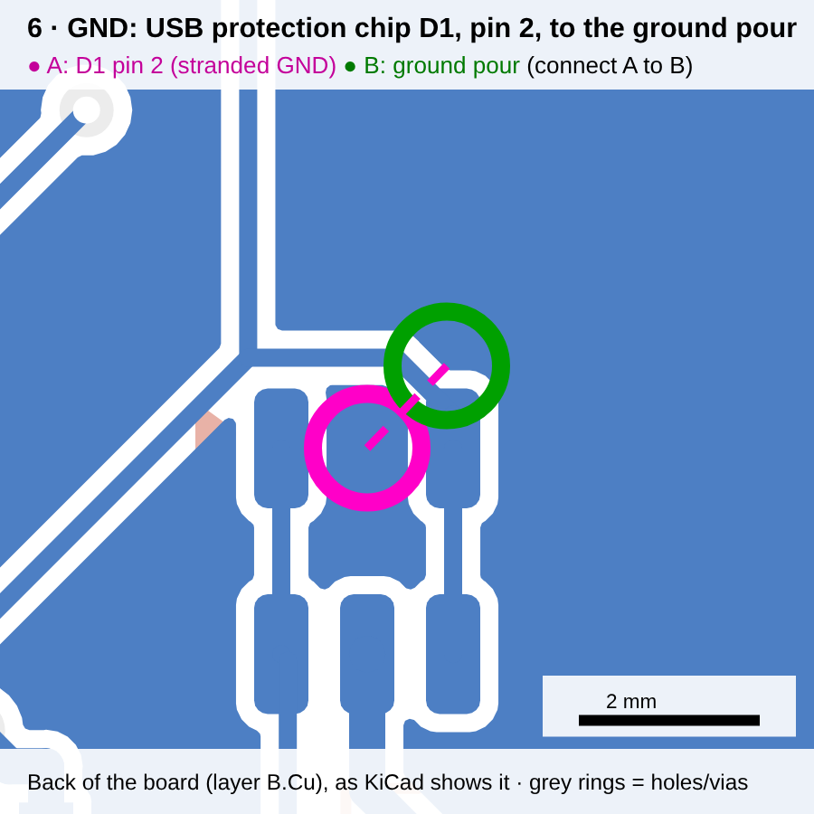

# KiCad for first-timers: opening, checking and finishing the Tattle Phone board

You don't need to know KiCad to order this board. If the routing is complete,
the factory files are already generated for you (see `../ORDERING.md`). This guide
is for looking the board over, and for finishing a connection or two by hand if
any are left. Every step says exactly what to click.

## 1. Install and open

1. Install **KiCad 10** from <https://www.kicad.org/download/>. Accept the defaults, including
   the libraries.
2. Get the project onto your computer: on GitHub, open the `ajansen7/random` repo,
   click **Code → Download ZIP**, and unzip it.
3. Open KiCad, then **File → Open Project…** and pick
   `tattle-phone/hardware/kicad/tattle_phone.kicad_pro`.
4. KiCad will say the files were made with an older version and offer to **upgrade** them.
   Click **Yes / Upgrade**. If it asks about missing footprint libraries, click **OK**:
   the board has its own copies.

The project window has two main buttons:
- **Schematic Editor** (the circuit drawing). It's laid out as a "netlist": pins carry name
  labels, and matching names are connected.
- **PCB Editor** (the physical board). This is where everything below happens.

## 2. Find your way around the PCB Editor

| To… | Do this |
|---|---|
| Zoom | Mouse scroll wheel |
| Pan | Hold the middle mouse button (or the scroll wheel) and drag |
| Fit the whole board on screen | Press **Home** |
| See front vs back copper | The **Layers** panel on the right. Click `F.Cu` (red, front) or `B.Cu` (blue, back) to make it active. Clicking the eye icon hides a layer |
| Look at it in 3D | **View → 3D Viewer** (Alt+3). Drag to rotate. This is the best way to sanity-check it |
| Undo anything | **Ctrl+Z** |

Big filled areas are the ground "pours". Thin lines are traces (wires), small circles are
vias (holes that link front and back), and the gold or silver shapes are the pads parts solder to.

## 3. Check the board (Design Rules Checker)

1. Press **B** first. That refills the ground pours. Always do this before checking.
2. **Inspect → Design Rules Checker**, then click **Run DRC**.
3. Three tabs matter:
   - **Violations:** problems. Expected and safe to ignore: *"Courtyards overlap"* between
     `LEDn` and `SWn` (the key LEDs sit beside their switches on purpose), *"silkscreen"*
     items, and *"footprint doesn't match library"*.
   - **Unconnected Items:** connections that still need copper. This should read **0**.
     If it doesn't, see step 4.
   - **Schematic Parity:** should be empty.
4. Click any line in the list and KiCad zooms to it and highlights it.

## 4. Finishing a leftover connection (only if Unconnected Items isn't 0)

A leftover shows as a thin straight "rat's nest" line between two pads that should be joined.

1. In the DRC list, double-click the unconnected item. KiCad zooms there.
2. In the Layers panel, click the layer the pad is on (`B.Cu` for almost everything on
   this board except the keys and LEDs).
3. Press **X** (*Route Single Track*). Click on the starting pad, then move the mouse toward
   the other end. The router draws the trace and **shoves other traces out of the way**,
   which is the thing my scripts couldn't do. Click to place corners, and double-click on the
   destination pad to finish.
   - If it won't get through on this layer, press **V** while routing to drop a **via** and carry
     on on the other side.
   - **Esc** cancels the current trace; Ctrl+Z undoes a finished one.
4. For a **ground** leftover, there's an easier fix: press **Ctrl+Shift+V** (*Add Via*), click
   right next to the stranded ground pad on a clear spot, then in the dialog that pops up
   set **Net** to `GND`. Then route a short trace (X) from the pad to the via.
5. Press **B**, run DRC again, repeat until **Unconnected Items = 0**.
6. **File → Save** (Ctrl+S).

If you get stuck, take a screenshot of the area and the DRC message and send it to me.
I'll tell you exactly where to click.

## 4b. The six connections on this board, one by one

The current board has exactly these six open. For each one: run DRC (step 3), go to the
**Unconnected Items** tab, and **double-click** the matching line. KiCad zooms there and
draws a thin straight line (the "ratsnest") between the two things that need joining.
Then do what the row says. All six are on the **back** layer, so click **`B.Cu`** in
the Layers panel first.

In the pictures, **pink A** is the stranded pad and **green B** is the nearest copper it
should join. Traces and the ground pour are both blue, so a trace looks like a blue
strip with a white outline.

| # | Picture | What it is | How to fix it |
|---|---|---|---|
| 1 |  | Battery line: charger chip **U2** pin 2 isn't joined to the rest of the **VBAT** trace (about 4 mm away) | Press **X**, click on U2 pin 2 (the small pad at A), and move toward B. KiCad will try to push the neighbouring traces aside; follow where it finds room. If it's blocked, press **V** to hop to the front layer, go around, press **V** again to come back, and finish on the VBAT trace at B |
| 2 |  | Ground: the **#** key switch's lower ground leg | Press **X**, click the switch's round pad at A, and draw a short trace to the blue ground area at B (about 2 mm). Double-click to finish |
| 3 |  | Ground: the same switch's upper leg | Same as #2 |
| 4 |  | Ground: LED level-shifter chip **U8** pin 3 (and its capacitor C17, already joined to it) | Press **X** from U8 pin 3 to the ground area at B (about 1 mm). If a trace is in the way, let the router shove it |
| 5 |  | Ground: LED power switch **Q2** pin 2 | Same idea, about 1 mm |
| 6 |  | Ground: USB protection chip **D1** pin 2 | Same idea, about 1.3 mm |

**Alternative for any ground one (#2–#6), if drawing the trace gets fiddly:** press
**Ctrl+Shift+V** (Add Via), click a clear spot right next to the stranded pad, and set its
net to **GND** in the dialog. Then press **X** and draw a tiny trace from the pad to the via.
The via drops through to the front-side ground, which is connected.

After each fix, press **B** (refill) and re-run DRC. The Unconnected count should go down by one.
When it says **0**, save (Ctrl+S) and you're done.

## 5. Make the factory files

Easiest: after saving, tell me the board is done and push it (or send it to me), and I'll
generate everything with `kicad_gen/make_fab.py`. Or do it yourself in KiCad:

1. **File → Fabrication Outputs → Gerbers (.gbr)…**
   - Output directory: `fab/gerbers/`
   - Leave the default layers ticked, then click **Plot**
   - In the same dialog click **Generate Drill Files…**, then **Generate**
   - Zip the `fab/gerbers/` folder
2. **File → Fabrication Outputs → Component Placement (.pos)…**: format CSV, units mm,
   **separate files for front and back**, then **Generate Position File**.
3. **Tools → Generate Bill of Materials** (or use `kicad/bom.csv`).

Then follow `../ORDERING.md` for what to upload and which options to pick.
